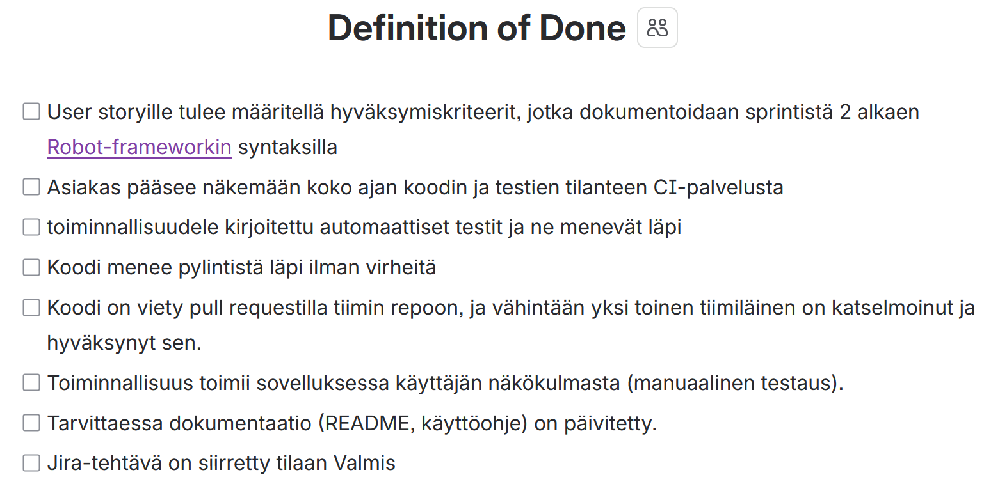

# Ohtu-projekti

Ohjelmistotuotanto-kurssin miniprojekti, ryhmä 6

[](https://github.com/xNPx3/ohtu-projekti/actions/workflows/main.yml)

Unit-test coverage (`src/modules`): **61%** · [HTML report from the latest CI run](https://github.com/xNPx3/ohtu-projekti/actions/workflows/main.yml?query=branch%3Amain)

## IF 4H isn't up.

- [ ] When the add button is pressed we should take the current fields from the `SourceEditor` and then do a database insert with those values. If possible refresh UI, so `SourceViewer` viewer shows the new result.

## Sovelluksen käyttö


Sovelluksen näkymä on jaettu kolmeen osaan:

**Työkalupalkki (ylhäällä)** sisältää painikkeet lähteen lisäämiseen (Add),
muokkaamiseen (Edit), poistamiseen (Delete) ja valinnan poistamiseen (Uncheck)
sekä hakukentän, jolla lähdelistaa voi suodattaa.

**Lomake (vasemmalla)** sisältää lähteen tietokentät: kirjoittaja, otsikko,
julkaisija, osoite, vuosi, tägit ja viiteavain (ID). Lomakkeella lisätään uusia
lähteitä ja muokataan olemassa olevia.

**Lähdelista (oikealla)** näyttää kaikki tallennetut lähteet selattavana listana.
Kun käyttäjä klikkaa lähdettä, sen tiedot avautuvat vasemmalle lomakkeelle,
jolloin lähdettä voi muokata tai sen voi poistaa. Uncheck-painike poistaa
valinnan ja tyhjentää lomakkeen uutta lähdettä varten.

## Asennus

Vaatimukset: [uv](https://docs.astral.sh/uv/) 0.13.7 tai uudempi.

1. Kloonaa repositorio:

   ```bash
   git clone <repositorion-osoite>
   cd ohtu-projekti
   ```

2. Asenna riippuvuudet:

   ```bash
   uv sync
   ```

## Käynnistys

```bash
uv run ohtu
```

## Definition of Done


## Database

Create the SQLite database and add example references with:

```bash
uv run init_database
```


## Backlog

https://docs.google.com/spreadsheets/d/1CUKP8nsRdaTxp9El2b2zLZC0YImahDFkzQHll-x9INw/edit?gid=0#gid=0
