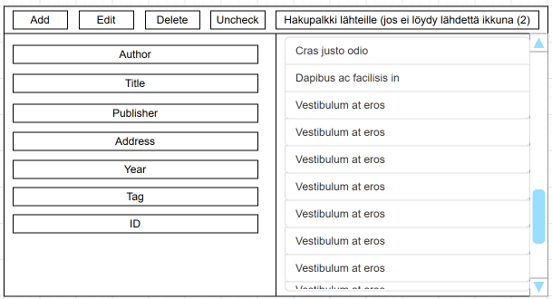
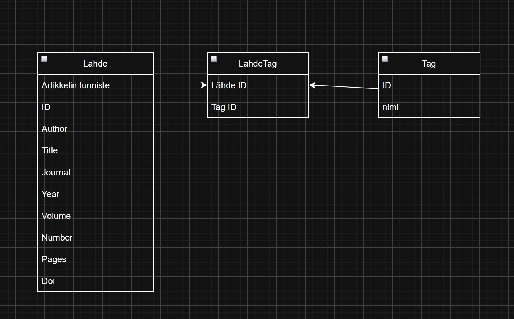

# Ohtu-projekti

Ohjelmistotuotanto-kurssin miniprojekti, ryhmä 6

[](https://github.com/xNPx3/ohtu-projekti/actions/workflows/main.yml)

## IVAN's TODO -- Done

- [x] Take a look at the project structure; mainly: [__init__.py](src/ohtu/__init__.py), [main.py](src/ohtu/windows.main.py) [database.py](src/modules/database.py)
  Documentation for [pyqt6](https://www.pythonguis.com/pyqt6-tutorial/)
- [x] Make a new `uv` command: `uv run init_database`, this should make the database and also add some fake data to it. Use or expand [database.py](src/modules/database.py) functionality
- [x] Currently the [main.py](src/ohtu/windows.main.py)'s `SourceViewer` displays fake data and not anything in the database. Remove the fake data and make the UI display the references/sources in the database.
  1. There is functionality for this in [database.py](src/modules/database.py), the UI just needs to use it.
  2. Each SourceViewer's elements should be of type `Source`, class already exists but it's not used at all and also not implemented.
  3. It would be very good if `Source` had the ID of the source/reference it displays, so we can later use it.
- [x] Currently the UI throws away all references to buttons and such, make the them member variables where it makes sense, so in init functions: `self.(variable name) = value` rather than `(variable name) = value`

## IF 4H isn't up

- [ ] When the add button is pressed we should take the current fields from the `SourceEditor` and then do a database insert with those values. If possible refresh UI, so `SourceViewer` viewer shows the new result.

## Sovelluksen käyttö



Sovelluksen näkymä on jaettu kolmeen osaan:

**Työkalupalkki (ylhäällä)** sisältää painikkeet lähteen lisäämiseen (Add),
muokkaamiseen (Edit), poistamiseen (Delete) ja valinnan poistamiseen (Uncheck)
sekä hakukentän, jolla lähdelistaa voi suodattaa.

**Lomake (vasemmalla)** sisältää lähteen tietokentät: kirjoittaja, otsikko,
julkaisija, osoite, vuosi, tägit ja viiteavain (ID). Lomakkeella lisätään uusia
lähteitä ja muokataan olemassa olevia.

**Lähdelista (oikealla)** näyttää kaikki tallennetut lähteet selattavana listana.
Kun käyttäjä klikkaa lähdettä, sen tiedot avautuvat vasemmalle lomakkeelle,
jolloin lähdettä voi muokata tai sen voi poistaa. Uncheck-painike poistaa
valinnan ja tyhjentää lomakkeen uutta lähdettä varten.

## Asennus

Vaatimukset: [uv](https://docs.astral.sh/uv/) 0.13.7 tai uudempi.

1. Kloonaa repositorio:

   ```bash
   git clone <repositorion-osoite>
   cd ohtu-projekti
   ```

2. Asenna riippuvuudet:

   ```bash
   uv sync
   ```

## Käynnistys

```bash
uv run ohtu
```

## Database

Create the SQLite database and add example references with:

```bash
uv run init_database
```



## Backlog

https://docs.google.com/spreadsheets/d/1CUKP8nsRdaTxp9El2b2zLZC0YImahDFkzQHll-x9INw/edit?gid=0#gid=0
